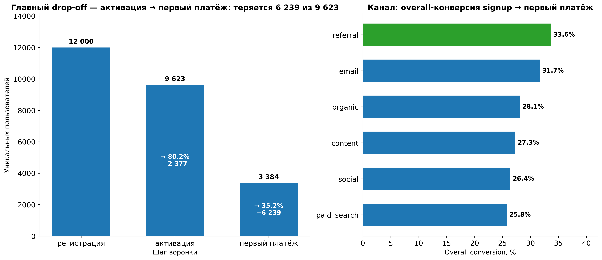
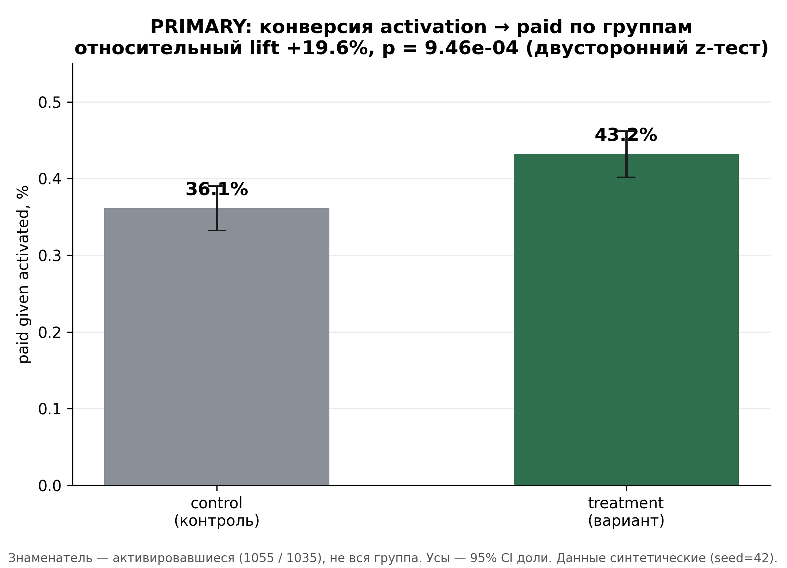
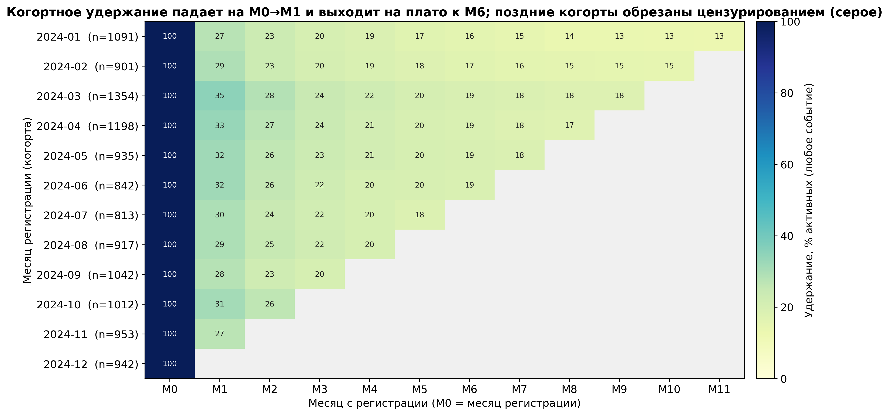
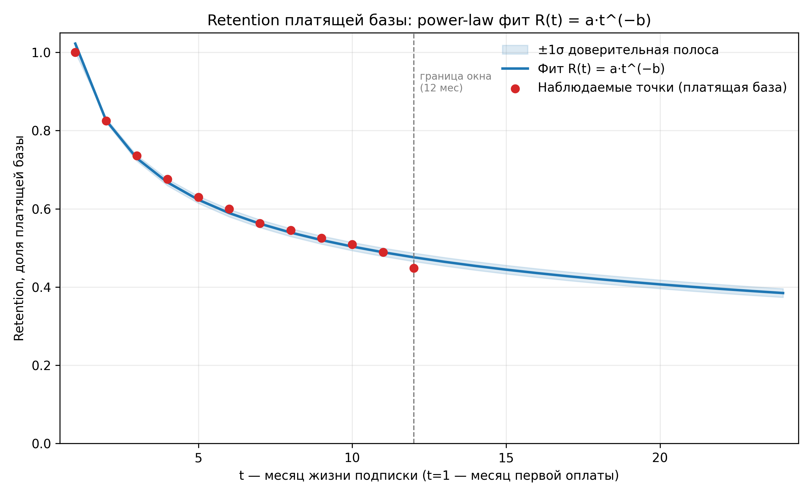
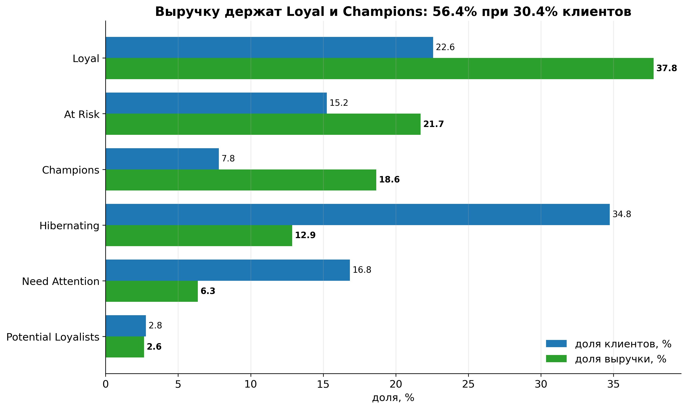

# product-ab-funnel-analytics — что сильнее двигает выручку: uplift конверсии или удержание?

Подписочный B2C-сервис тестирует новый онбординг-флоу. Этот кейс связывает результат A/B-эксперимента с воронкой `signup → activation → paid`, когортным удержанием и юнит-экономикой, чтобы ответить на один управленческий вопрос: **стоит ли раскатывать вариант и какой рычаг — конверсия или удержание — даёт больший прирост выручки.**

> **Вердикт: раскатывать (SHIP).** Вариант поднимает целевую конверсию `activation → paid` на **+19.59%** относительно (p=0.000946) без ухудшения guardrails. На равном шаге **+10%** относительно конверсия добавляет к LTV на привлечённого **+10.0%**, удержание — **+8.65%** (≈**1.2×**): рычаги сопоставимы по силе, но измерен и значим только конверсионный.

---

## Проблема

Подписочный B2C-сервис тратит бюджет на привлечение, но выручка упирается в узкое место. Нужно закрыть одним разбором три вопроса:

1. **Эффект.** Даёт ли новый онбординг статистически значимый прирост целевой конверсии `activation → paid`? Не нарушено ли соотношение групп (SRM)?
2. **Узкое место.** Где воронка теряет пользователей и какой шаг даёт наибольший потенциальный прирост?
3. **Решение.** Что сильнее двигает выручку — uplift конверсии или удержание — и каков итог: ship / extend / stop?

Ситуация усложняется тем, что у сервиса **три разных grain'а данных** (пользователь, событие, транзакция) и **8616** из **12000** пользователей не платят ни разу — любая денежная метрика обязана явно объявить знаменатель, иначе числа между ногами расходятся в разы.

---

## Данные

| Параметр | Значение |
|---|---|
| Источник | **SYNTHETIC** — сгенерирован детерминированным генератором `data/raw/_generate.py`, **seed = 42** |
| Период | `2024-01-01` … `2024-12-31` (366 дней); окно A/B-эксперимента `2024-03-01` … `2024-04-30` |
| Объём | `events.csv` **38892** события · `transactions.csv` **16477** транзакций · `users.csv` **12000** пользователей |
| Grain | `users` — 1 пользователь; `events` — 1 событие; `transactions` — 1 списание или возврат |
| A/B-когорта | **2552** пользователя (control **1271** / treatment **1281**) |
| Валюта | RUB |

**Ограничения (важны для чтения чисел):**

- **Полностью синтетика.** Эффект варианта, форма кривой удержания и воронка **заложены генератором** — значимый A/B-результат ожидаем по построению и не является свидетельством о реальном продукте. Все числа — правдоподобные изобретения.
- **12-месячное окно и правое цензурирование.** Данные кончаются `2024-12-31`, поэтому поздние когорты (особенно декабрьская, **942** signup) не успевают набрать продления: падение LTV и payer-rate по календарю когорт — артефакт окна, а не деградация.
- **Денежные метрики сужаются до плательщиков.** Только **3384** из **12000** пользователей платят; ARPU/LTV/RFM требуют явного знаменателя (вся база или плательщики).
- **AOV дискретен** до тарифных цен 490 / 890 / 1590 ₽ — средний чек нельзя сравнивать без сегментации по тарифу.

Подробный контракт, схема связей и проверки целостности — в [`data/README.md`](data/README.md) и [`docs/insights/00-eda.md`](docs/insights/00-eda.md).

---

## Метод

Семь независимых ног, каждая — свой артефакт и своя машиночитаемая метрика. Вместе они отвечают на бизнес-вопрос с трёх сторон: деньги, воронка, эксперимент.

| # | Нога | Вопрос, который закрывает | Артефакт |
|---|---|---|---|
| 1 | `eda` | Чистота, grain, связи, цензурирование — можно ли вообще считать | [`docs/insights/00-eda.md`](docs/insights/00-eda.md) |
| 2 | `sql` | Месячная выручка, каналы, когорты, возвраты по тарифам | [`docs/insights/01-sql.md`](docs/insights/01-sql.md) |
| 3 | `cohorts` | Форма retention-кривой по месячным когортам | [`docs/insights/02-cohorts.md`](docs/insights/02-cohorts.md) |
| 4 | `rfm` | Сегменты плательщиков и концентрация выручки (Gini/Lorenz) | [`docs/insights/03-rfm.md`](docs/insights/03-rfm.md) |
| 5 | `ltv` | Power-law фит, LTV, CAC, payback — юнит-экономика | [`docs/insights/04-ltv.md`](docs/insights/04-ltv.md) |
| 6 | `funnel` | Шаги воронки, drop-off, срезы по каналу/платформе | [`docs/insights/05-funnel.md`](docs/insights/05-funnel.md) |
| 7 | `a/b` | SRM, значимость эффекта, guardrails, вердикт ship/extend/stop | [`docs/insights/06-ab.md`](docs/insights/06-ab.md) |

Логика связки: `eda` фиксирует контракт → `sql` считает деньги и воронку на корректном grain → `cohorts` + `ltv` дают форму удержания и юнит-экономику → `rfm` показывает, где сконцентрирована выручка → `funnel` локализует узкое место → `a/b` проверяет, что вариант бьёт именно в него, и выносит решение.

---

## Инсайты

### 1. Вся воронка держится на одном шаге: `activation → paid` забирает 72% потерь

Воронка сужается **12000 → 9623 → 3384**. Вход проходит ровно (**80.19%**, потеря **2377**), а целевой шаг — только **35.17%**. Один этот переход теряет **6239** из **8616** неплативших — **72%** всей убыли. Итоговая конверсия signup → paid — **28.20%**.



*См. [`docs/insights/05-funnel.md`](docs/insights/05-funnel.md) (дублируется в [`00-eda.md`](docs/insights/00-eda.md) и [`01-sql.md`](docs/insights/01-sql.md)).*

### 2. Вариант бьёт ровно в этот шаг — и значимо: SHIP

Целевая метрика `paid given activated`: control **36.11%** → treatment **43.19%**, то есть **+7.07 п.п.** (**+19.59%** относительно), z=**3.31**, p=**0.000946**, достигнутая мощность **0.911**. SRM нет (χ²=**0.0392**, p=0.843). Guardrails не деградировали: возвраты **3.39%** → **3.20%**, отмены среди плательщиков **48.82%** → **46.53%**. Направление устойчиво к выбору знаменателя — ITT-аналог `paid per signup` даёт **+16.41%** (p=0.007967).



*См. [`docs/insights/06-ab.md`](docs/insights/06-ab.md).*

### 3. Удержание падает сразу и выходит на плато — «дыра» в первых 30 днях

Когортное **activity**-удержание: M1 = **30.45%**, M3 = **22.12%**, M6 = **18.16%**, M11 = **12.74%**. Почти вся потеря — на переходе M0 → M1 (−69.55 п.п.). Отдельно, **удержание платящей базы** описывается чистым power law с R²=**0.9913** и b=**0.3077**: после M6 ядро стабильно. При этом на M1 **82.54%** активных — это платящие, то есть не-плательщики уходят почти сразу.



*Когортные activity-числа — [`docs/insights/02-cohorts.md`](docs/insights/02-cohorts.md); power-law фит — по **удержанию платящей базы**, [`04-ltv.md`](docs/insights/04-ltv.md).*

### 4. Конверсия и удержание сопоставимы по силе — но измерен только конверсионный рычаг

Юнит-экономика на 12 мес: LTV на привлечённого **1594.59 ₽**, на платящего **5654.59 ₽**, CAC **598.48 ₽**, LTV/CAC **2.66**, payback **4** месяца. Измеренный эффект варианта — **+16.41%** на `paid per signup` (ITT, p=**0.007967**): LTV на привлечённого **1856.27 ₽**. Экстраполяция *условного* лифта (`paid given activated`, +19.59%) на всех signup даёт **1906.97 ₽** (**+19.6%**) — это верхняя граница: активация в treatment была ниже, поэтому раскатка приносит +16.41%, а не +19.6%. Честное сравнение рычагов требует одного шага: при **+10%** относительно на каждый рычаг конверсия даёт **1754.05 ₽** (**+10.00%**), а удержание — **1732.45 ₽** (**+8.65%**), то есть **≈1.2×**, а не «вчетверо». Прежняя формулировка сравнивала **+19.6%** на конверсии с `b×0.9` — сдвигом кривой удержания всего на ~2–8% по месяцам, то есть рычаги разной величины. Вывод для решения: **раскатывать** — не потому, что конверсия «в разы» сильнее, а потому, что её эффект измерен и значим, тогда как у удержания нет ни эксперимента, ни оценки эффекта.



*См. [`docs/insights/04-ltv.md`](docs/insights/04-ltv.md).*

### 5. Выручка сконцентрирована: Gini 0.475, топ-20% дают 50.66%

На **3384** плательщика: топ-20% по monetary дают **50.66%** выручки, а топ-10% — **32.65%**, Gini = **0.475**. Два сегмента — Loyal (**37.77%**) и Champions (**18.65%**) — держат **56.4%** выручки при **30.4%** клиентов. При этом At Risk — это **2649950 ₽** под угрозой, а Hibernating (**34.8%** клиентов) даёт лишь **12.9%** выручки: массовая реактивация нерентабельна.



*См. [`docs/insights/03-rfm.md`](docs/insights/03-rfm.md).*

### 6. Каналы неравноценны: `referral` эффективнее `paid_search` в 2.6 раза по LTV/CAC

По конверсии лидирует **referral** (**33.65%**), по абсолютной выручке — **organic** (**3294570 ₽**), а **paid_search** — худший по отдаче (**25.79%** конверсии). По юнит-экономике разрыв ещё резче: LTV/CAC **4.45** у `referral` против **1.72** у `paid_search` (payback 2 против 6 мес).

*См. [`docs/insights/01-sql.md`](docs/insights/01-sql.md) и [`04-ltv.md`](docs/insights/04-ltv.md).*

---

## Рекомендации

Каждая рекомендация трассируется к инсайту и к конкретному числу. Развёрнутая версия — в [`docs/business_recommendations/recommendations.md`](docs/business_recommendations/recommendations.md).

1. **Раскатать вариант онбординга (SHIP).** → Инсайт 2. Эффект **+19.59%** относительно (p=**0.000946**), SRM нет, guardrails не хуже. Держать в пост-релизном мониторинге три метрики: activation rate, cancel rate среди плательщиков, `paid given activated`.
2. **Инвестировать в первые 30 дней, а не в привлечение.** → Инсайты 1 и 3. Целевой шаг держит **72%** потерь (**6239** из **8616**), а удержание теряет **69.55 п.п.** ровно на M0 → M1 — рычаг один и тот же.
3. **Закрыть платформенный разрыв на вебе.** → Инсайт 1 (срез `funnel`). Activation на `web` **72.59%** против `ios` **85.41%**, при том что оплата среди активировавшихся у всех платформ одинакова — проблема в онбординге веба (**2678** регистраций).
4. **Перераспределить бюджет с `paid_search` на `referral` и `organic`.** → Инсайт 6. LTV/CAC **1.72** против **4.45** — разница в **2.6 раза** при сопоставимых объёмах.
5. **Запустить отдельную программу удержания как долгосрочный трек, а не замену uplift'у.** → Инсайты 3–5. Сначала win-back At Risk (**2649950 ₽** под риском) и апсейл Loyal, массовую реактивацию Hibernating не финансировать.
6. **Проверить экономику дорогих тарифов.** → Инсайт 2/`sql`. Доля возвратов растёт с ценой: `pro` **3.55%** против `basic` **2.33%**.

---

## Требования / How to reproduce

**Окружение.** Python **3.11+** (проверено на 3.14) и зависимости из [`pyproject.toml`](pyproject.toml):

| Пакет | Версия |
|---|---|
| `pandas` | 3.0.3 |
| `numpy` | 2.4.4 |
| `matplotlib` | 3.10.9 |
| `duckdb` | 1.5.5 |
| `scipy` | 1.17.1 |
| `openpyxl` | 3.1.5 |

```bash
uv sync --all-groups        # или: pip install -r requirements.txt
uv run pytest -q            # 16 тестов: ядра, golden-воронка, SQL ↔ артефакты
```

**Аналитические ядра — из скиллов DSWoK, копия в репозитории.** Ноги не переписывают математику: `run_03_rfm.py` использует ядро `rfm`, `run_04_ltv.py` — `retention_ltv`, `run_05_funnel.py` — `funnel_analyzer`, `run_06_ab.py` — `ab_test_analyzer`. Все четыре лежат в [`vendor/`](vendor) (дословные копии `rfm-segmentation`, `retention-ltv-calculator`, `funnel-analysis`, `ab-test-analysis`), поэтому чистый клон запускается без внешних зависимостей. Чтобы взять живую версию скиллов вместо вендорной — задайте `DSWOK_SKILLS_ROOT`:

```bash
export DSWOK_SKILLS_ROOT="/path/to/dswok/.claude/skills"   # опционально
```

**Порядок прогона.** Нога `ltv` читает относительный lift из артефакта A/B-ноги, поэтому `run_06_ab.py` должен отработать до `run_04_ltv.py` (в репозитории `analysis/ab_metrics.json` уже закоммичен):

```bash
python analysis/run_03_rfm.py      # RFM: rfm_scored.csv, segment_summary.csv, rfm_metrics.json, 2 PNG
python analysis/run_05_funnel.py   # воронка: 05_funnel_steps.csv, 05_funnel_segments.csv, JSON, PNG
python analysis/run_06_ab.py       # A/B: 06_ab_counts.csv, ab_metrics.json, PNG
python analysis/run_04_ltv.py      # LTV: retention_points.csv, ltv_by_cohort.csv, ltv_metrics.json, PNG
python sql/run_01_sql.py           # SQL-нога
python sql/run_02_cohorts.py       # когорты
python scripts/eda_profile.py      # EDA
```
