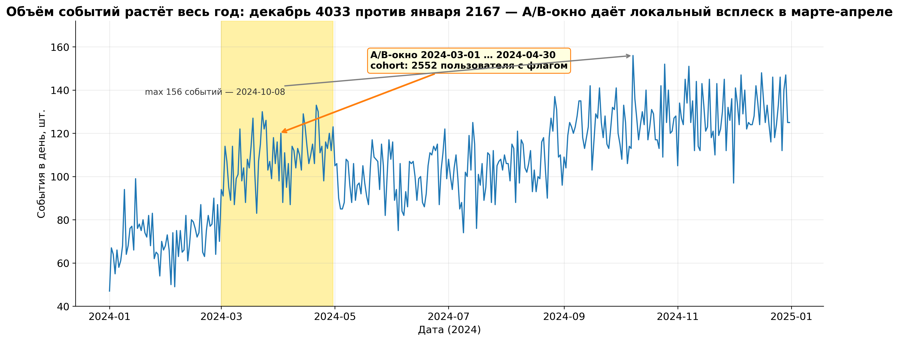
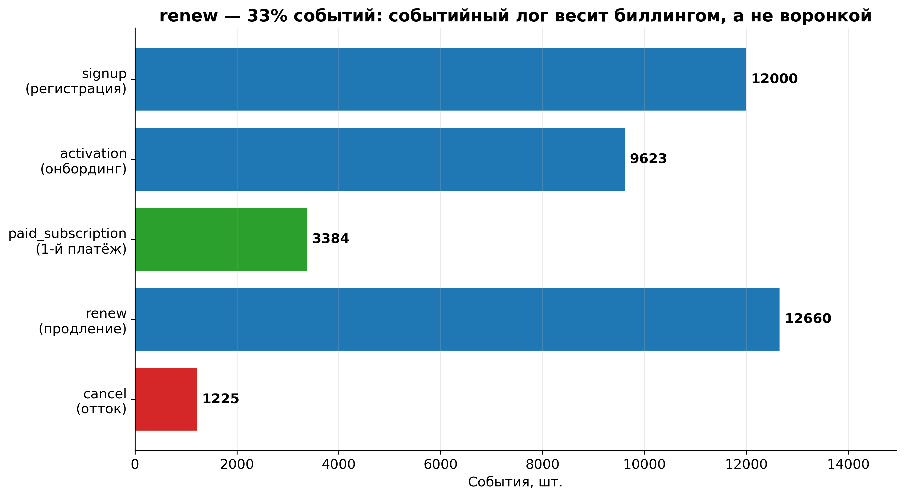
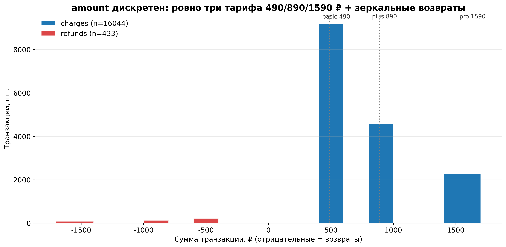
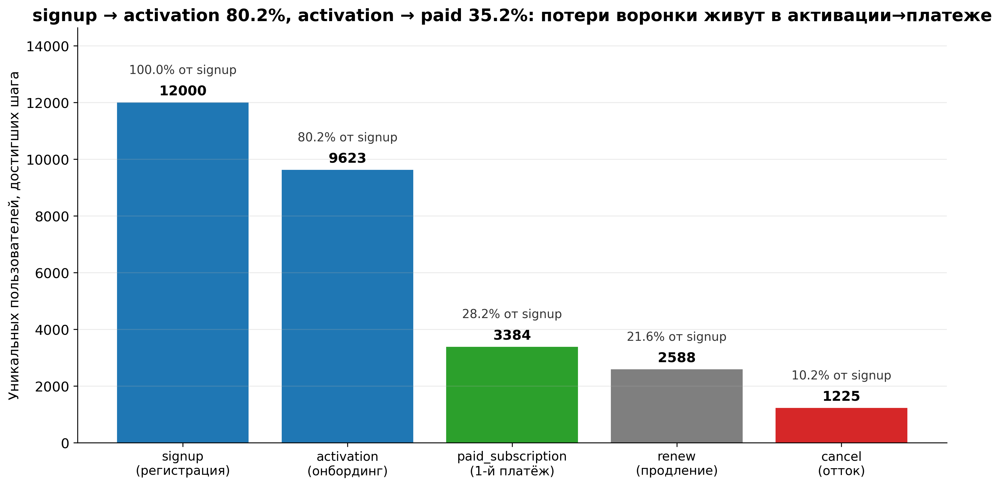
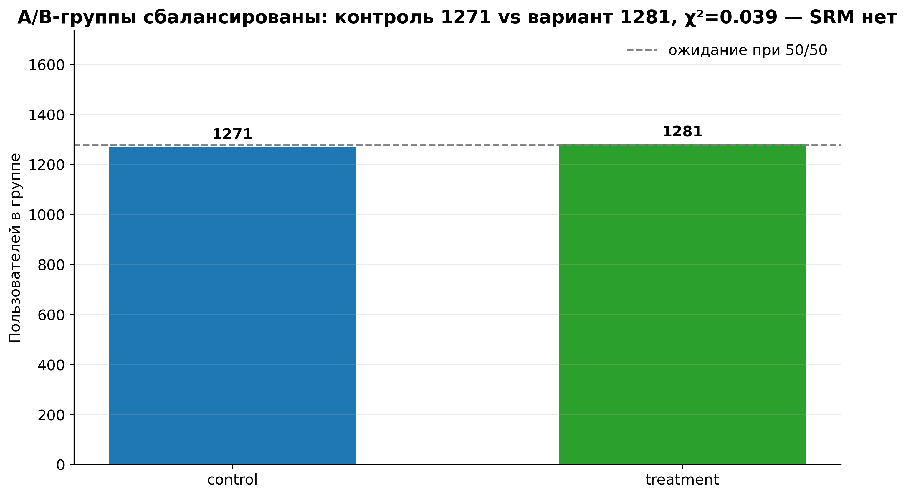

# Данные чистые и полностью связные — потолок анализа задают не грязь, а три разных grain'а и 8616 пользователей без платежей

**Дата:** 2026-10-14 · **Нога:** `eda` (Leg 01) · **Источник:** `data/raw/{users,events,transactions}.csv` (синтетика, seed=42) · **Скрипт:** [`scripts/eda_profile.py`](../../scripts/eda_profile.py) · **Числа:** [`analysis/eda_metrics.json`](../../analysis/eda_metrics.json)

---

## TL;DR — 38892 события, 16477 транзакций, 12000 пользователей; 0 битых FK, 0 дублей ключей, 0 nulls

Данные пригодны для всех семи ног без чистки: referential integrity идеальная (0 событий без пользователя, 0 транзакций без пользователя), ключи уникальны, null-ов нет ни в одной из трёх таблиц, а хронология жизненного цикла непротиворечива (0 событий раньше `signup_date`, 0 `renew` раньше первого платежа, 0 активаций после платежа).

Единственное, что реально ограничивает анализ, — **grain и цензурирование, а не грязь**:

- три таблицы живут на трёх разных grain'ах (`user`, `event`, `transaction`) и напрямую не сшиваются без агрегации: наивный `events JOIN transactions ON user_id` даёт **156223** строки вместо 38892 (×4.02 раздутие);
- **8616** из 12000 пользователей не имеют ни одной транзакции (не заплатили) — все денежные ноги автоматически сужаются до **3384** плательщиков;
- **1225** уникальных пользователей с `cancel`, из них **537** отвалились, не дожив ни до одного `renew`;
- декабрьские когорты поймали right-censoring (год кончается 2024-12-31) — это потолок окна, а не аномалия.

A/B-когорта внутри данных корректна и балансирована: **2552** пользователя (control 1271 / treatment 1281), χ²=0.039 при пороге 6.63 — **SRM нет**, окно `2024-03-01 … 2024-04-30` совпадает с `users.signup_date` до дня.

---

## Контракт данных

### Grain, ключи, связи

| Таблица | Строк | Grain (1 строка =) | Первичный ключ | Внешний ключ |
|---|---:|---|---|---|
| `users.csv` | 12000 | 1 приобретённый пользователь (когортный член) | `user_id` — уникален, дублей 0 | — |
| `events.csv` | 38892 | 1 продуктовое событие одного пользователя в момент времени | суррогатного нет; уникален по (`user_id`, `event_ts`, `event_name`) — дублей 0 | `user_id` → `users.user_id` |
| `transactions.csv` | 16477 | 1 списание (charge) **или** возврат (refund) по подписке | `transaction_id` — уникален, дублей 0 | `user_id` → `users.user_id` |

Схема связей: `users` — родитель для обеих fact-таблиц (`1 : N`), `events` и `transactions` между собой **не связаны напрямую** — только через `user_id`, то есть на уровне пользователя, а не события. Это ключевое ограничение для SQL-ноги (см. `fan-out` ниже).

### Row-loss по шагам джойнов

| Шаг | Left rows | Right rows | Matched rows | Rows lost | Потерянные сущности |
|---|---:|---:|---:|---:|---|
| `users INNER JOIN events ON user_id` | 12000 | 38892 | 38892 | **0** | пользователей без событий: **0**; событий без пользователя: **0** |
| `users INNER JOIN transactions ON user_id` | 12000 | 16477 | 16477 | **0** | пользователей без транзакций: **8616**; транзакций без пользователя: **0** |
| `users LEFT JOIN events LEFT JOIN transactions` (3-way, на grain пользователя) | 12000 | — | 12000 | 0 | пользователей с событиями и платежами: **3384**; только с событиями: **8616**; только с платежами: **0** |

**Ни одна строка не теряется на джойнах и ни одна не является сиротой.** 8616 — это не потеря, а бизнес-факт: неплатившие пользователи, у которых по определению нет записей в леджере.

### Ловушка fan-out (зафиксирована для SQL-ноги)

- наивный `events JOIN transactions ON user_id` → **156223** строки вместо ожидаемых 38892 (×4.02);
- выручка после такого джойна задваивается, потому что каждая транзакция пользователя повторяется по числу его событий (в среднем 3.241 события на пользователя и 4.869 транзакции на плательщика);
- правило для SQL-ноги: агрегировать `transactions` до `user_id` **до** сшивки с `events`, либо джойнить обе таблицы к `users`, а не друг к другу.

---

## Профиль данных



**Чтение:** X — календарный день 2024 года, Y — число событий в день; жёлтая полоса — окно A/B-эксперимента `2024-03-01 … 2024-04-30`.

**Что бросается в глаза:**
- объём почти монотонно растёт: декабрь **4033** события против января **2167** (×1.86), при том что месячные signup'ы на пике в марте-апреле, а не в декабре;
- средний день — **106.3** события, p95 — **141**, максимум **156** (2024-10-08), минимум **47** (2024-01-01); данные покрывают все **366** дней года;
- в марте-апреле виден локальный всплеск ровно на границах A/B-окна (март **3289**, апрель **3334** против февраля **2087**) — это эффект маркетинговой кампании, а не эксперимента.

**Вывод:** временной ряд полный и без пропущенных дней — когортные и LTV-ноги могут строить месячные сетки без интерполяции, но при интерпретации роста объёма надо помнить, что он смешан из притока новых пользователей и накопления биллинговых `renew`.

**Типы, пропуски, дубликаты:**

| Таблица | Строк | Колонок | Nulls (всего) | Дубли строк целиком |
|---|---:|---:|---:|---:|
| `events` | 38892 | 8 исходных (+ служебный `event_date`) | **0** | **0** |
| `transactions` | 16477 | 6 исходных (+ служебный `is_refund_bool`) | **0** | **0** |
| `users` | 12000 | 7 | **0** | **0** |

- `user_id` во всех трёх файлах читается как `str` (`u_000001`) — приведение обязательно, иначе ведущие нули и префикс теряются;
- даты на диске лежат как `str` и парсятся явно: `events.event_ts` → `datetime64[us]` (`2024-01-01 00:06:13 … 2024-12-31 23:55:42`), `transactions.transaction_date` → `datetime64[us]` (`2024-01-05 … 2024-12-31`), `users.signup_date` → `datetime64[us]` (`2024-01-01 … 2024-12-31`);
- `is_refund` в CSV — строки `'True'`/`'False'`, не boolean: **16044** / **433**; конвертация в bool перед фильтрами обязательна, иначе `is_refund == True` вернёт пусто.

**Категориальные распределения (события vs пользователи):**

| Разрез | Значение | События | Пользователи |
|---|---|---:|---:|
| `event_name` | `signup` | 12000 | 12000 |
| | `activation` | 9623 | 9623 |
| | `paid_subscription` | 3384 | 3384 |
| | `renew` | 12660 | 2588 |
| | `cancel` | 1225 | 1225 |
| `platform` | `android` | 17141 | 5251 |
| | `ios` | 13604 | 4071 |
| | `web` | 8147 | 2678 |
| `country` | `RU` | 30336 | 9350 |
| | `KZ` | 3450 | 1073 |
| | `BY` | 2186 | 716 |
| | `AM` | 1628 | 483 |
| | `Other` | 1292 | 378 |
| `channel` | `organic` | 10763 | 3313 |
| | `paid_search` | 8278 | 2652 |
| | `social` | 6907 | 2201 |
| | `referral` | 5138 | 1480 |
| | `content` | 4055 | 1280 |
| | `email` | 3751 | 1074 |



**Чтение:** горизонтальные бары — число строк событий по типам; цвет кодирует роль шага (зелёный — целевое действие, красный — отток).

**Что бросается в глаза:**
- `renew` — **12660** строк, **33%** всего лога; это биллинг, а не воронка, и именно он тянет объём;
- `signup` строго по одному на пользователя (12000 строк / 12000 пользователей, дублей 0) — таблица `users` и событие `signup` согласованы до дня;
- `cancel` — самый редкий тип: **1225** строк (**3.1%** лога).

**Вывод:** при работе с `events` фильтруйте по `event_name` до агрегаций — иначе метрики воронки размываются биллинговым шумом `renew`.

**Числовые распределения:**

| Метрика | n | Mean | Median | Min | Max | Std |
|---|---:|---:|---:|---:|---:|---:|
| `amount` (все транзакции, ₽) | 16477 | 719.09 | 490.00 | −1590.00 | 1590.00 | 457.62 |
| `amount` только charges | 16044 | 760.72 | 490.00 | 490.00 | 1590.00 | 380.10 |
| `amount` только refunds | 433 | −823.49 | −490.00 | −1590.00 | −490.00 | 414.67 |
| `acquisition_cost` (CAC, ₽) | 12000 | 598.48 | 540.42 | 400.00 | 900.00 | 165.87 |
| событий на пользователя | 12000 | 3.241 | 2 | 1 | 15 | 3.002 |
| транзакций на плательщика | 3384 | 4.869 | 4 | 1 | 14 | 3.592 |



**Чтение:** X — сумма транзакции в ₽ (отрицательная = возврат), Y — число транзакций; синяя серия — списания, красная — возвраты; пунктиры — тарифные цены.

**Что бросается в глаза:**
- `amount` **дискретен до шести значений**: −1590, −890, −490, 490, 890, 1590 — распределения как такового нет, есть три тарифа и их зеркальные возвраты;
- тарифный микс: basic **9396** / plus **4716** / pro **2365** транзакций, и все 16477 строк совпадают со своей тарифной ценой (расхождений `plan` ↔ `|amount|`: **0**);
- выбросы по IQR на charges — **2281** строк (14.2%), и это **не ошибки**: IQR вырожден (Q1=Q3=490), поэтому любой plus/pro автоматически «выброс».

**Вывод:** суммы нельзя анализировать как непрерывную величину — средний чек бессмысленно сравнивать без сегментации по тарифу; для LTV-ноги корректнее модель «выручка = тариф × число месяцев», а не AOV-экстраполяция.

**Финансовый итог (для сверки в других ногах):** gross charges **12205060.0** ₽, возвраты **−356570.0** ₽, net revenue **11848490.0** ₽; доля возвратов **2.63%** (433 из 16477).



**Чтение:** X — шаг, Y — число уникальных пользователей, достигших шага; подписи сверху — доля от `signup`.

**Что бросается в глаза:**
- `signup → activation` — **80.2%** (9623 из 12000);
- `activation → paid_subscription` — **35.2%** (3384 из 9623), то есть целевая конверсия держит 72% всех потерь воронки;
- `renew` достигают **2588** пользователей (**21.6%** от signup): 796 плательщиков из 3384 не дожили до второго платежа;
- `cancel` — **1225** пользователей (**10.2%** от signup).

**Вывод:** основной drop-off — между активацией и первым платежом, а не на входе; именно здесь сосредоточен потенциальный прирост, и именно здесь работает тестируемый вариант.

---

## Качество и аномалии

### Что проверено и чисто (0 проблем)

| Проверка | Результат |
|---|---:|
| Nulls во всех трёх таблицах | **0** |
| Дубли строк целиком | **0** |
| Дубли `users.user_id` | **0** |
| Дубли `transactions.transaction_id` | **0** |
| Дубли `events(user_id, event_ts, event_name)` | **0** |
| События без пользователя (сироты FK) | **0** |
| Транзакции без пользователя (сироты FK) | **0** |
| Пользователи без события `signup` | **0** |
| События раньше `users.signup_date` | **0** |
| Расхождение даты `signup`-события и `users.signup_date` | **0** |
| `renew` раньше первого `paid_subscription` | **0** |
| `activation` позже первого `paid_subscription` | **0** |
| Транзакции раньше события оплаты (first txn > paid_ts) | **0** |
| `activation` без `signup` / `paid` без `activation` / `cancel` без `paid` | **0 / 0 / 0** |
| Дата в будущем (> 2024-12-31) | **0** |
| Расхождение `experiment_group` между `events` и `users` | **0** |
| Пользователь с >1 эксперимент-группой | **0** |
| `plan` не соответствует тарифной цене | **0** |

### Аномалии, которые найдены — все объяснимые

**1. Возвраты приходят отрицательными суммами: 433 строки, из них с положительным знаком — 0.** Флаг `is_refund` совпадает со знаком `amount` в **100%** строк, то есть `amount.sum()` уже net. Грязью это не является, но ловушка для наивной выручки — и она закрыта: `gross` считается по `amount > 0`, `net` — по сумме всех.

**2. 8616 пользователей без единой транзакции.** Это 71.8% базы — неплатившие. Любая денежная метрика (ARPU, LTV, RFM, CAC payback) обязана явно объявить знаменатель: 12000 (вся база) или 3384 (плательщики). Разница в 3.55 раза — типовая причина расхождения чисел между ногами.

**3. 537 отмен без предшествующего `renew`.** Единственный неочевидный случай: 1225 cancels, у 537 из них нет ни одного `renew` до отмены. Это не нарушение — так выглядит отвал на первой же попытке продления; `renew` после `cancel` — 0, то есть порядок `paid → renew* → cancel` держится строго.

**4. 27 совпадающих таймстампов между разными пользователями.** Дубли по составному ключу при этом 0, максимум событий на пользователя в сутки — 2 (это `signup` + `activation` одного дня). Совпадения — следствие генерации с точностью до секунды, не дубликаты записей.

**5. Right-censoring декабря.** Пользователи, пришедшие в декабре (**942** signup'а), физически не могут набрать продления за пределами 2024-12-31. Последняя месячная когорта неполная по определению, и падение выручки/LTV на ней — артефакт окна, а не деградация продукта. Когортной и LTV-ноге это надо фиксировать явно.

**6. Отсутствующие сущности, которых в данных нет** (проверено): нет сессий, нет отмен/пауз подписки кроме события `cancel`, нет возвратов в середине месяца отдельным типом, нет событий с пустым `experiment_group` внутри окна (**0** пользователей окна остались без флага) и нет флагованных вне окна (**0**).

**Вывод:** чистка не нужна ни на одном шаге — набор можно грузить как есть и тратить бюджет анализа на метрики, а не на ремедиацию.

---

## Связь с экспериментом



**Чтение:** высота баров — число пользователей в control и treatment, пунктир — ожидаемые 1276 при идеальном 50/50.

**Что бросается в глаза:**
- когорта — **2552** пользователя: control **1271**, treatment **1281**, отношение **0.9922**;
- χ² относительно 50/50 = **0.039** при критическом значении **6.63** (df=1, α=0.01) → **SRM не обнаружен**;
- флаг `experiment_flag=1` стоит ровно на **10184** событиях этих пользователей — то есть флаг однозначно определяет когорту и на уровне событий.

**Что важно для следующей ноги:**

| Свойство | Значение |
|---|---|
| Окно эксперимента | `2024-03-01 … 2024-04-30` (**61** день) |
| Пользователей с `signup_date` в окне | **2552** |
| Из них помечено группой | **2552** (непомеченных внутри окна: 0) |
| Помечено вне окна | **0** |
| Пользователей вне когорты (`none`) | **9448** |
| Событий у когорты | **10184** |
| Расхождение `experiment_group` events ↔ users | **0** |

Конверсия внутри когорты по группам (для передачи в `a/b`-ногу — здесь только как sanity-check контракта):

| Группа | Пользователей | Активировались | Заплатили | Activation % | **Paid given activated, %** |
|---|---:|---:|---:|---:|---:|
| control | 1271 | 1055 | 381 | 83.01 | **36.11** |
| treatment | 1281 | 1035 | 447 | 80.80 | **43.19** |

**Вывод:** ассайнмент чистый, окно совпадает с данными до дня, группы сбалансированы — A/B-нога может считать эффект без ремедиации SRM; целевая метрика ограничена activated-подмножеством (1055 и 1035 пользователей), а разница в активации между группами (83.01% vs 80.80%) в данные не заложена и должна трактоваться как шум, а не как эффект варианта.

---

## Выводы для следующих ног: какой grain брать

- **`sql`** — base grain: `events joins users on user_id` (38892 строки). Транзакции агрегировать до `user_id` (3384 строки) **до** сшивки: прямой `events JOIN transactions ON user_id` даёт **156223** строки (×4.02) и задваивает выручку. Идеальный контракт: `users` как центр, `events` и `transactions` приджойнены к нему side-by-side.
- **`cohorts`** — grain: **user × signup-month** (`users.signup_date` → month), удержание считать по `transactions` (первая покупка + продления), а не по `renew`-событиям, если нужна выручка. База — 12000 пользователей / 12 месячных когорт; декабрьскую когорту помечать как censored (**942** signup'а без полного окна наблюдения).
- **`rfm`** — grain: **user**, только плательщики (**3384** пользователя). Recency — от `2024-12-31` или от даты последней транзакции пользователя; Monetary — **gross charges** (`amount > 0`, **16044** строки); 433 возврата исключены (правило зафиксировано в `03-rfm.md`), поэтому база — не все 16477 транзакций.
- **`ltv`** — grain: **user × когортный месяц**; выручка из `transactions` (не из `events`). Учитывать дискретность `amount` (490/890/1590) и правое цензурирование декабря; CAC брать из `users.acquisition_cost` (mean **598.48**, диапазон 400–900) — для payback нужен именно пользовательский, а не средний CAC.
- **`funnel`** — grain: **user × шаг воронки**; шаги брать из уникальных пользователей по `event_name` (12000 → 9623 → 3384) и **фильтровать `renew`/`cancel` из шагов воронки** — иначе «шаги» перестают быть монотонными (12660 `renew`-строк больше, чем 3384 плательщиков). Максимальный drop-off — на `activation → paid_subscription` (35.2%).
- **`a/b`** — grain: **user**, выборка ограничена `experiment_group != 'none'` (**2552**). Целевая метрика — `paid_given_activated` (control **36.11%** vs treatment **43.19%**), знаменатель — activated (1055 / 1035), не вся группа. Окно `2024-03-01 … 2024-04-30`, SRM-проверка уже пройдена (χ²=0.039).

---

## Что не вошло в эту ногу

- **Статистическая значимость эффекта** — это `a/b`-нога; здесь зафиксированы только счётчики и баланс групп.
- **Retention-кривая и power-law fit** — `ltv`/`cohorts`; EDA не фитит кривые.
- **RFM-сегменты, Gini/Lorenz по выручке** — `rfm`; для этого нужна агрегация по плательщикам, которой здесь нет.
- **Маркетинговая атрибуция** (какой канал даёт плательщиков) — пересечение `channel` и конверсии; в EDA проверено только распределение канала, не его связь с оплатой.
- **Качество генератора** (`data/raw/_generate.py`) — датасет синтетический и помечен как таковой; выводы о «реальном продукте» из него невозможны.

---

## Артефакты и воспроизводимость

- Числа: [`analysis/eda_metrics.json`](../../analysis/eda_metrics.json) (все значения этой заметки, машиночитаемо)
- Графики: [`figures/daily-event-volume.png`](../../figures/daily-event-volume.png), [`figures/event-name-distribution.png`](../../figures/event-name-distribution.png), [`figures/amount-distribution.png`](../../figures/amount-distribution.png), [`figures/funnel-stage-users.png`](../../figures/funnel-stage-users.png), [`figures/experiment-group-balance.png`](../../figures/experiment-group-balance.png)
- Скрипт: `scripts/eda_profile.py` (pandas 3.0.3; явные dtype, `observed=True`, CoW-safe, без `inplace`)

```bash
# все числа + все графики
uv run --project "<env>" python scripts/eda_profile.py

# только числа (без PNG)
uv run --project "<env>" python scripts/eda_profile.py --no-figures
```

Замечание по формату: числа в отчёте приведены без разделителей разрядов (38892, а не 38 892), чтобы их можно было сверять со значением из `eda_metrics.json` буквальным поиском.
