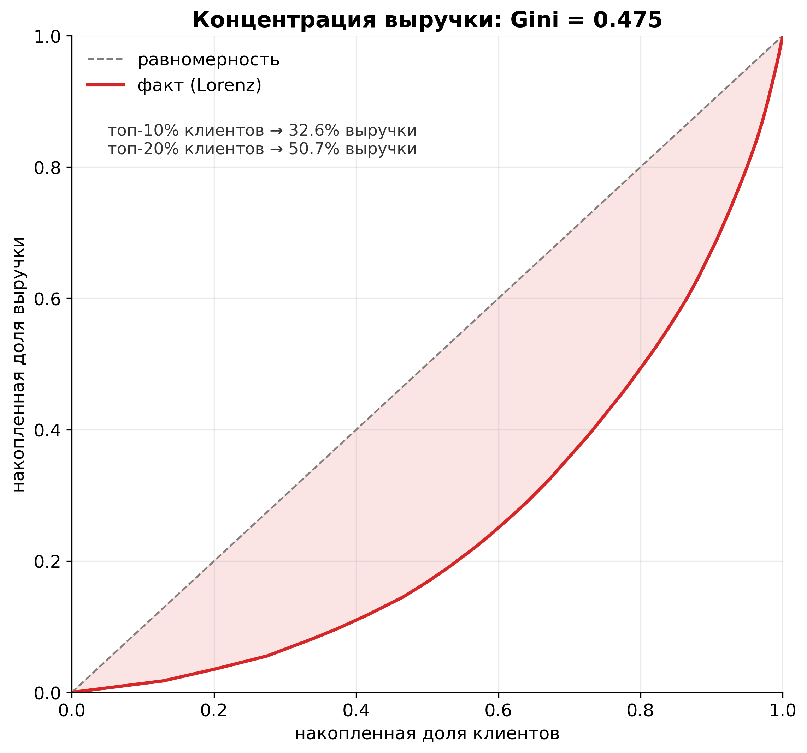

# Топ-20% плательщиков дают 50.66% выручки: RFM раскладывает 3384 плательщика на 6 сегментов при Gini 0.475

**Дата:** 2026-10-14 · **Нога:** `rfm` (Leg 03) · **Источник:** `data/raw/transactions.csv` (синтетика, seed=42) · **Скрипт:** [`analysis/run_03_rfm.py`](../../analysis/run_03_rfm.py) · **Числа:** [`analysis/rfm_metrics.json`](../../analysis/rfm_metrics.json) · **SQL:** [`sql/03_rfm.sql`](../../sql/03_rfm.sql)

---

## TL;DR — 3384 плательщика, 6 сегментов, Gini 0.475; Champions+Loyal держат 56.4% выручки при 30.4% клиентов

RFM строится на **плательщиках** (3384 пользователя из 12000 — остальные 8616 не заплатили ни разу, см. [Leg 01](../../docs/insights/00-eda.md)). Из 16477 транзакций в скоринг идут только **16044 списания**; **433 возврата** исключены (2.63%).

Три факта, которые задают всю картину:

- **выручка резко сконцентрирована**: топ-20% клиентов по monetary дают **50.66%** всей выручки, а топ-10% — **32.65%**, Gini = **0.475**;
- **деньги держат два сегмента** — Loyal (37.8% выручки) и Champions (18.7%): вместе **56.4%** выручки при **30.4%** клиентов (concentration ratio 1.67 и 2.39);
- **почти треть клиентов почти не платит**: Hibernating — это **34.8%** клиентов, но лишь **12.9%** выручки; вместе с Need Attention их concentration ratio — 0.37 и 0.38.

Итог для бизнеса: рост выручки дешевле брать из удержания Loyal/Champions и win-back At Risk (под риском **2649950 ₽**), а не из массовой реактивации Hibernating.

---

## Методология

### Контракт и правило обработки возвратов

| Параметр | Значение |
|---|---|
| Grain входа | 1 строка = 1 транзакция (`charge` или `refund`) |
| Grain выхода | 1 строка = 1 плательщик (`user_id`) |
| Транзакций всего | **16477** = **16044** списания + **433** возврата |
| **Правило возвратов** | **берём только списания (`amount > 0`)**; исключено **433** строки (**2.63%**) |
| Пользователей только с возвратами | **0** → база плательщиков не сужается: **3384** |
| Выручка (gross charges) | **12205060 ₽** (net с возвратами — 11848490 ₽) |
| Дата отсчёта recency (snapshot) | **2024-12-31** — максимальная дата транзакции в датасете |
| Бинов на измерение | **4** (квартили; скоры 1..4, RFMScore 3..12) |

**Почему списания, а не net.** Возврат — это не покупка: он не должен увеличивать `frequency` (число покупок) и не должен «обнулять» monetary у пользователя, который всё же платил. Поэтому `frequency` = число списаний, `monetary` = сумма списаний (gross). Возвраты в данных — независимый шум (~3% списаний) и не меняют жизненный цикл подписки; их исключение не выкидывает ни одного плательщика (пользователей только с возвратами — 0).

**Recency.** `recency` = дней от последней покупки пользователя до snapshot **2024-12-31** (конец периода анализа). 0 = купил в последний день, максимум в данных — 359 дней.

### Соглашение о скорах

Скоры считает каноническое ядро `.claude/skills/rfm-segmentation/scripts/rfm.py` (делегирование, не переписывание) — ранговый квартиль, `ceil(rank / n × 4)`:

| Измерение | Что значит «хорошо» | Скейл |
|---|---|---|
| **R** (recency) | купил недавно | 4 = недавний … 1 = давний |
| **F** (frequency) | покупал часто | 4 = самый частый … 1 = самый редкий |
| **M** (monetary) | много потратил | 4 = крупная сумма … 1 = мелкая |
| **RFMClass** | строка из трёх цифр | `444` = лучший, `111` = худший |
| **RFMScore** | R + F + M | 3..12, больше = лучше |

Сегмент присваивается по комбинации R/F/M (не по сумме), поэтому `444` и `233` не схлопываются в один бакет. Пороги при `bins=4`: top = 4, mid = 3, low = 2.

DuckDB-порт в [`sql/03_rfm.sql`](../../sql/03_rfm.sql) воспроизводит ядро **бит-в-бит** (ранговый скор с детерминированным тай-брейком по `user_id ASC`): прогон SQL даёт те же 3384 строки и то же распределение по сегментам, что и Python-ядро — проверка зафиксирована в `rfm_metrics.json` → `sql_parity.segment_counts_match = true`.

---

## Сегменты: клиенты vs выручка


**Чтение:** горизонтальные пары баров на сегмент; синий — доля клиентов, зелёный — доля выручки. Если зелёный длиннее синего (ratio > 1), сегмент переиндексирован по выручке; если короче — недоиндексирован.

| Сегмент | Клиенты | Доля клиентов, % | Выручка, ₽ | Доля выручки, % | Ratio | Ср. recency, дн | Ср. frequency | Ср. monetary, ₽ | Ср. RFM |
|---|---:|---:|---:|---:|---:|---:|---:|---:|---:|
| **Loyal** | 764 | 22.58 | 4610160 | 37.77 | 1.67 | 13.59 | 7.92 | 6034.24 | 10.37 |
| **At Risk** | 516 | 15.25 | 2649950 | 21.71 | 1.42 | 63.02 | 6.89 | 5135.56 | 8.36 |
| **Champions** | 264 | 7.80 | 2276760 | 18.65 | 2.39 | 5.59 | 10.20 | 8624.09 | 12.00 |
| **Hibernating** | 1176 | 34.75 | 1569950 | 12.86 | 0.37 | 171.86 | 1.76 | 1334.99 | 4.35 |
| **Need Attention** | 570 | 16.84 | 775140 | 6.35 | 0.38 | 11.22 | 2.47 | 1359.89 | 7.13 |
| **Potential Loyalists** | 94 | 2.78 | 323100 | 2.65 | 0.95 | 12.04 | 2.77 | 3437.23 | 8.47 |

Медианы по базе: recency **23** дня, frequency **4** покупки, monetary **2450 ₽**; средний RFMScore — **7.5**.

---

## Концентрация выручки: Gini 0.475, топ-10% → 32.65%, топ-20% → 50.66%



**Чтение:** по X — накопленная доля клиентов (от беднейших по monetary к богатейшим), по Y — накопленная доля выручки; пунктир — линия полного равенства. Чем больше площадь между кривой и пунктиром, тем выше концентрация.

- **Gini = 0.475** — умеренно-высокая концентрация (для сравнения: 0 = все платят поровну, 1 = вся выручка у одного);
- **топ-10% клиентов → 32.65% выручки**, **топ-20% → 50.66%**;
- сегментация «имеет бизнес-смысл»: она режет именно тех, кто несёт деньги, а не случайные 10%.

---

## Инсайты

### 1. Выручка держится на двух сегментах — Loyal и Champions дают 56.4% при 30.4% клиентов

Вместе **Champions (18.65%)** и **Loyal (37.77%)** приносят **56.43%** выручки. Это концентрация ratio 2.39 и 1.67 — оба сегмента переиндексированы по деньгам. Любая деградация удержания в этой группе бьёт по выручке непропорционально сильно: потеря 10% их клиентов — это ~5.6 п.п. всей выручки.

### 2. Крупнейший денежный сегмент — не Champions, а Loyal (37.8% выручки)

Champions малочисленны (**264**, 7.8%) и почти исчерпаны: средняя frequency **10.20**, средний recency **5.59** дня, средний monetary **8624 ₽**. Денежный центр — Loyal: **764** клиента, **4610160 ₽**, но frequency ниже (7.92) и monetary тоже (6034 ₽). **Рычаг роста — дотянуть Loyal до Champions**: у них ещё свежий recency (13.6 дня), значит окно апсейла/частоты покупок открыто.

### 3. At Risk — 2649950 ₽ под угрозой: 516 клиентов давно не платят, но исторически платили много

**At Risk**: 516 клиентов, **21.71%** выручки, средний recency **63.02** дня при frequency 6.89 и monetary 5136 ₽. Это «спящие деньги»: они уже доказали готовность платить, но перестали. Вместе с Hibernating это **34.58%** выручки от **1692** клиентов — именно здесь win-back окупается лучше всего, потому что CAC уже уплачен.

### 4. Hibernating — это 34.8% клиентов, но лишь 12.9% выручки: массово их спасать невыгодно

**Hibernating**: **1176** клиентов (самый большой сегмент), **1569950 ₽** = **12.86%** выручки, concentration ratio **0.37**, средний recency **171.86** дня, frequency **1.76**, monetary **1335 ₽**. Они пришли, заплатили один раз и ушли. Возврат стоит почти столько же, сколько их LTV, поэтому реактивация должна быть дешёвой (email/push) и таргетированной, а не массовой.

### 5. Need Attention (570 клиентов, 6.35% выручки) — недавние, но редкие: рычаг второго платежа

**Need Attention**: **570** клиентов, **775140 ₽**, средний recency всего **11.22** дня (то есть они активны прямо сейчас), но frequency **2.47** и monetary **1360 ₽** — они ещё не разогнались. Это аудитория для онбординга «второго платежа» и апгрейда тарифа: они не потеряны, а недогреты. Potential Loyalists (**94** клиента, **323100 ₽**, ratio 0.95) — тот же профиль, но ещё меньше и с большим чеком (3437 ₽).

---

## Что не вошло в эту ногу

- **Retention-кривая и power-law fit** — `ltv`/`cohorts`; RFM даёт срез, а не динамику.
- **Статистическая значимость A/B-эффекта** — `a/b`; RFM не разбивает по `experiment_group` (плательщиков в когорте мало).
- **Маркетинговая атрибуция сегментов** (какой канал рождает Champions) — пересечение `channel` и сегмента; здесь не считалось.
- **Различие plan-микса** (basic/plus/pro): monetary смешивает тариф и число месяцев. `avg_monetary` — это «тариф × месяцы», а не средний чек.

---

## Артефакты и воспроизводимость

- Числа: [`analysis/rfm_metrics.json`](../../analysis/rfm_metrics.json) (все значения этой заметки, машиночитаемо)
- Таблицы: [`data/processed/rfm_scored.csv`](../../data/processed/rfm_scored.csv) (3384 пользователя), [`data/processed/segment_summary.csv`](../../data/processed/segment_summary.csv) (6 сегментов)
- SQL: [`sql/03_rfm.sql`](../../sql/03_rfm.sql) (DuckDB; воспроизводит ядро бит-в-бит)
- Графики: [`figures/rfm-segments.png`](../../figures/rfm-segments.png), [`figures/rfm-lorenz.png`](../../figures/rfm-lorenz.png)
- Скрипт: `analysis/run_03_rfm.py` (делегирует RFM-математику в каноническое ядро; pandas 3.0.3; явные dtype, CoW-safe, без `inplace`)

```bash
# все числа + обе таблицы + оба графика
# нужен python с зависимостями из requirements.txt;
# для импорта ядра скилла задайте DSWOK_SKILLS_ROOT=<путь>/.claude/skills
python analysis/run_03_rfm.py
```

Замечание по формату: числа в отчёте приведены без разделителей разрядов (12205060, а не 12 205 060), чтобы их можно было сверять со значением из `rfm_metrics.json` буквальным поиском.
